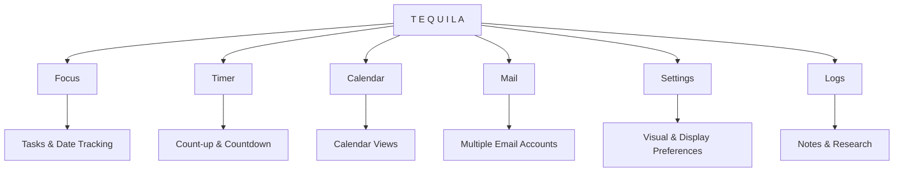
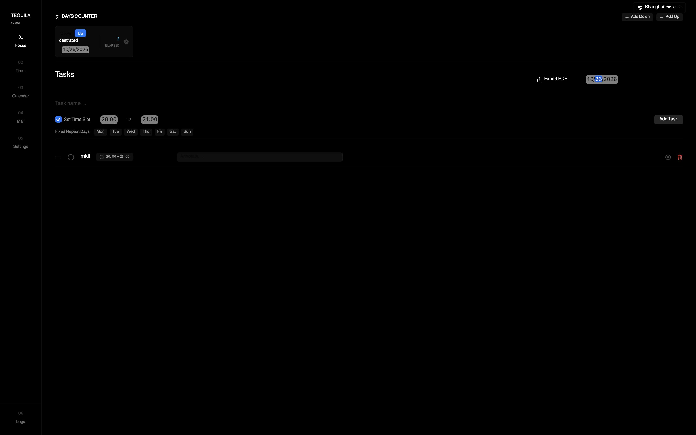
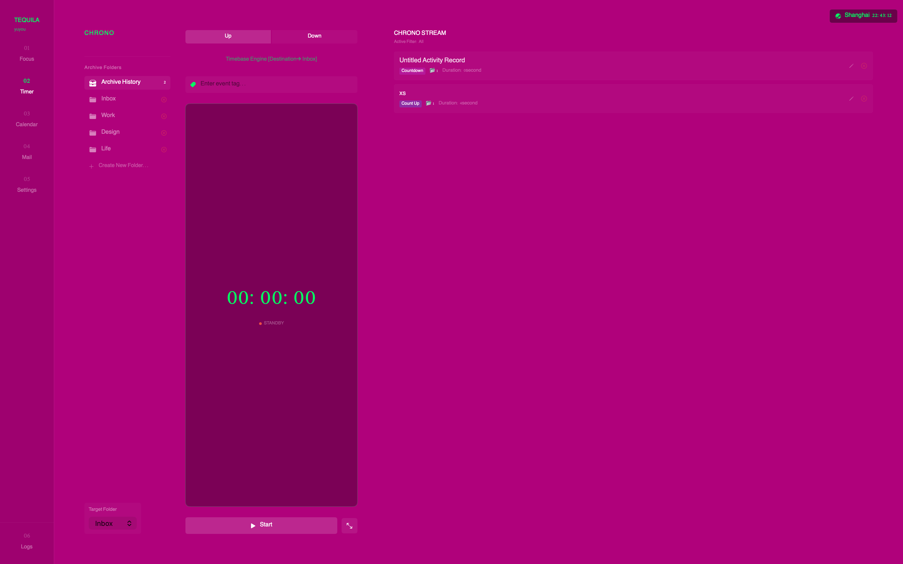
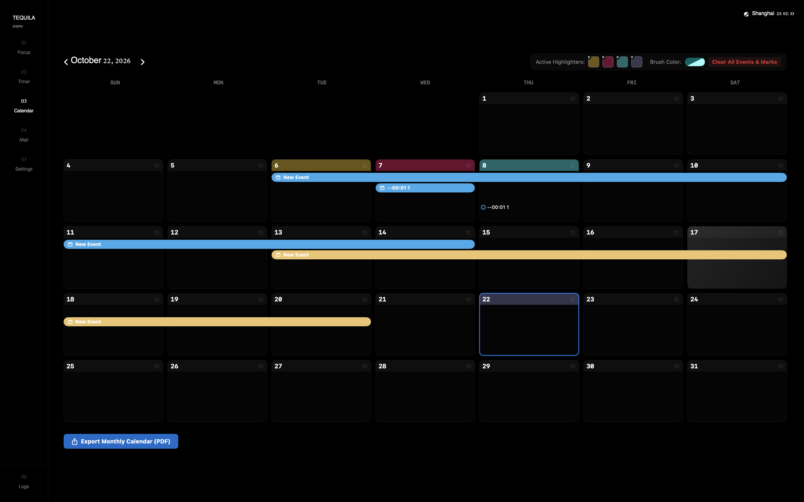
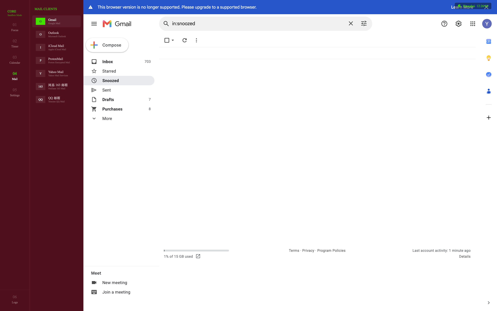
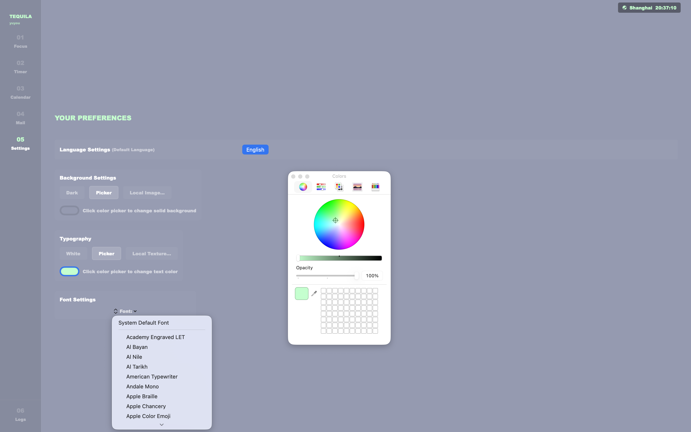
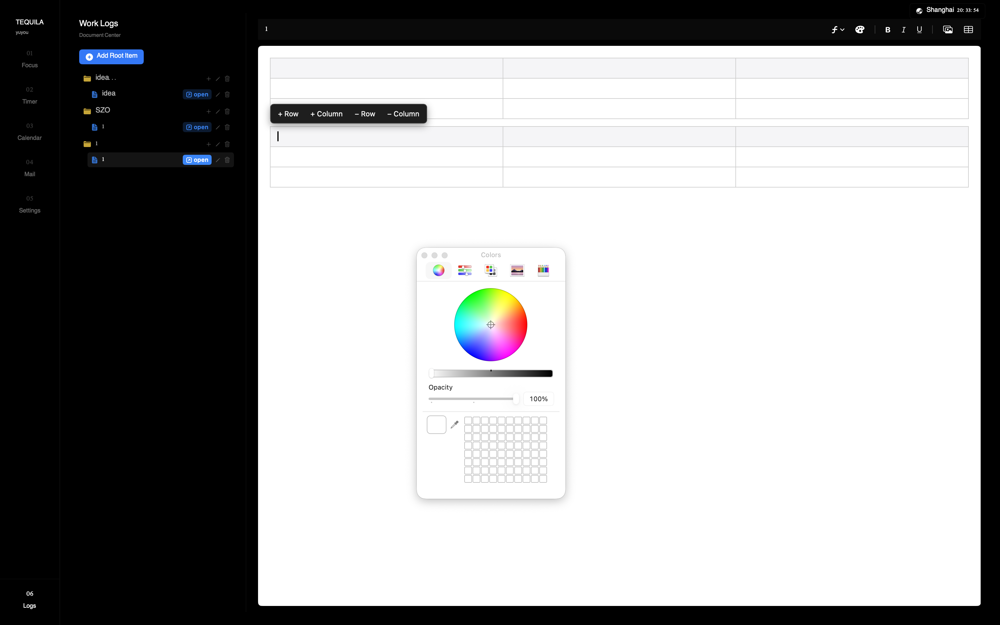
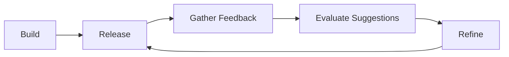

<div align="center">

# T E Q U I L A

**A native macOS workspace for planning, time management, communication, and notes.**

Built with Swift, SwiftUI, and AppKit.

[](https://github.com/caiyuyou1227-glitch/tequila/releases)
[](https://github.com/caiyuyou1227-glitch/tequila/stargazers)
[](https://github.com/caiyuyou1227-glitch/tequila/forks)
[](https://github.com/caiyuyou1227-glitch/tequila/issues)


*A workspace designed to make productivity feel as considered as the work itself.*

</div>

---

## 00 / THE IDEA

Most productivity tools make a trade-off: feature-rich but visually overwhelming, or beautifully designed but limited in function.

**Tequila explores a different balance.**

Built as a native macOS application, Tequila brings task management, time tracking, calendar planning, email, settings, and notes into one workspace. Its interface is designed around clarity, customization, and the practical details of everyday work.

The goal is not simply to fit more tools into one application. It is to make them work together without making the experience feel complicated.

---

## 01 / THE SYSTEM

Tequila is organized into six interconnected modules.



| Module | Purpose |
|---|---|
| **Focus** | Manage tasks, track dates, and organize weekly plans |
| **Timer** | Track time with count-up and countdown timers |
| **Calendar** | View and customize calendar layouts |
| **Mail** | Access multiple email accounts in one workspace |
| **Settings** | Customize the interface and display preferences |
| **Logs** | Organize notes, research, and reference materials |

Each module addresses a different part of the workflow while contributing to one consistent workspace.

---

## 02 / THE MODULES

### 01 — Focus

A task management space built around visibility, scheduling, and flexible organization.

**Task Management**
- Create and organize tasks.
- Track task completion status.
- Hide selected tasks after creating them without deleting them.

**Date Tracking**
- Use count-up counters to track elapsed days.
- Use countdown counters to track days remaining.

**Weekly Scheduling**
- Assign fixed tasks to selected weekdays.
- Remove an individual weekday without clearing the task's other scheduled days.
- Clear all fixed-day settings for a task when needed.

**All-Day Scheduling**
- Use the `All Day` option when a task should be scheduled for the entire day.

**Visual Markers**
- Highlight `Fix` and `Pin` with fluorescent highlighter yellow to make important tasks easier to identify.

**Daily Workflow**
- Keep task status and scheduling information visible.
- Export daily task information for reference.



---

### 02 — Timer

A flexible time-tracking space for focused work and project timing.

- Run count-up timers to track elapsed time.
- Use countdown timers to work toward a defined duration.
- Organize projects into folders.
- Keep time tracking within the same workspace as task planning.



---

### 03 — Calendar

A customizable calendar designed to make time easier to read and organize.

- Customize calendar colors and typography.
- Adjust visual highlights to distinguish important dates.
- Export monthly calendar views.
- Keep calendar presentation consistent with personal preferences.



---

### 04 — Mail

A centralized interface for working with multiple email accounts.

Supported email services include:

- Gmail
- Outlook
- iCloud Mail
- Proton Mail
- Yahoo Mail
- 163 Mail
- QQ Mail

The goal is to reduce the need to switch between separate email applications while keeping communication within the broader workspace.



---

### 05 — Settings

A dedicated space for adjusting the workspace to individual preferences.

- Customize backgrounds, colors, and typography.
- Adjust visual preferences and interface settings.
- Configure the region displayed in the upper-right corner.
- Let the displayed region update according to Settings.
- Reposition the displayed region using the mouse.

The interface is designed to be adaptable rather than locked to a single visual style.



---

### 06 — Logs

A space for keeping notes, research, and reference materials organized.

- Create and organize notes.
- Sort materials into folders.
- Work with text, images, and tables.
- Keep research and supporting information accessible within the workspace.



---

## 03 / DESIGN SYSTEM

Tequila treats interface design as part of the product's functionality, not as decoration added afterward.

### Visual Hierarchy

The interface prioritizes useful information and reduces unnecessary text and visual clutter.

### Customization

Colors, typography, backgrounds, and other display preferences allow the workspace to adapt to different users and workflows.

### Functional Coherence

Tasks, timers, calendars, email, and notes serve different purposes but belong to the same working environment.

### Feedback-Driven Refinement

The interface has evolved through feedback from GitHub, Reddit, and Xiaohongshu. Suggestions are evaluated and applied where they improve usability, clarity, or the overall experience.

Rather than treating the first release as a finished product, Tequila continues to evolve through iteration.

---

## 04 / ENGINEERING

### Project Structure

```text
tequila/
├── screenshots/
│   ├── focus.png
│   ├── timer.png
│   ├── calendar.png
│   ├── mail.png
│   ├── settings.png
│   └── logs.png
├── README.md
└── ...
```

### Technology Stack

| Technology | Role |
|---|---|
| **Swift** | Core application development |
| **SwiftUI** | Interface construction and declarative UI |
| **AppKit** | Native macOS integration |

Tequila is built specifically for macOS, with an emphasis on a native desktop experience.

---

## 05 / ITERATION

Tequila is developed through a continuous cycle of building, gathering feedback, evaluating suggestions, and refining the product.



### Release History

| Version | Focus | Changes |
|---|---|---|
| **v1.0** | Initial release | Introduced the core macOS productivity workspace |
| **v1.1** | Interface refinement | Simplified the interface and removed unnecessary text |
| **v1.2** | Date tracking | Introduced count-up and countdown day tracking |
| **v1.3** | Task timing | Expanded count-up and countdown functionality within Tasks |
| **v1.4** | Task clarity | Improved completed and incomplete task visibility; made the delete control red |
| **v1.5** | Weekly planning | Added weekday selection for fixed tasks, with separate controls for removing one weekday or clearing all fixed-day settings |
| **v1.6** | Task organization | Added `All Day` scheduling, fluorescent yellow highlights for `Fix` and `Pin`, and the ability to hide selected tasks without deleting them |

### v1.6 — Latest Development Focus

The v1.6 update focuses on making task organization more flexible and visually clear.

- **All Day:** Adds an all-day option to `Fix`.
- **Visual Markers:** Uses fluorescent highlighter yellow for `Fix` and `Pin`.
- **Task Visibility:** Allows selected tasks to be hidden after creation without deleting them.

These changes build on earlier updates to weekly scheduling and task management, making the system more adaptable to different planning habits.

[View all releases →](https://github.com/caiyuyou1227-glitch/tequila/releases)

---

## 06 / PRODUCT DEMONSTRATION

See Tequila in action.

<div align="center">

[](https://youtu.be/N34f45MKJFo)

**[Watch the product demonstration on YouTube →](https://youtu.be/N34f45MKJFo)**

</div>

---

## 07 / GET STARTED

### Download

Visit the [GitHub Releases page](https://github.com/caiyuyou1227-glitch/tequila/releases) to find available builds.

### Clone the Repository

```bash
git clone https://github.com/caiyuyou1227-glitch/tequila.git
cd tequila
```

Open the project in Xcode to explore the source code.

---

## 08 / COMMUNITY

Tequila is shaped by feedback, discussion, and continued iteration.

### GitHub

- [Explore the repository](https://github.com/caiyuyou1227-glitch/tequila)
- [Report an issue](https://github.com/caiyuyou1227-glitch/tequila/issues)
- [Join discussions](https://github.com/caiyuyou1227-glitch/tequila/discussions)
- [Browse releases](https://github.com/caiyuyou1227-glitch/tequila/releases)

### Xiaohongshu

The project has also been shared on Xiaohongshu to collect reactions and suggestions about its design and functionality.

[View the project post on Xiaohongshu →](https://www.xiaohongshu.com/discovery/item/6aba2e980000000002013350?source=webshare&xhsshare=pc_web&xsec_token=AB1ofPMD2UY6B3QkhKaT0Fb_gjfxCuPxq-BM8BlBuhLOw=&xsec_source=pc_share)

Reported engagement on the project post:

| Metric | Count |
|---|---:|
| Likes | 60 |
| Saves | 28 |
| Comments | 13 |
| Shares | 4 |

These figures reflect engagement with the project post, not verified downloads or active users.

### Reddit

Reddit is another channel for gathering feedback and evaluating suggestions from users outside the project's immediate community.

---

## 09 / BEHIND THE PROJECT

Tequila grew from an interest in the relationship between design, organization, and everyday productivity.

My background in fashion design, fashion management, and 2D/3D creative production has shaped how I approach software: a product should not only work well, but also communicate clearly and feel coherent as a whole.

Building Tequila has meant working across interface design, feature development, user feedback, and product iteration. Each release is an opportunity to reconsider how the application works and how its design supports real use.

The project continues to evolve as new ideas are tested and improvements are made.

---

<div align="center">

**T E Q U I L A**

*Function, considered. Design, intentional.*

[Repository](https://github.com/caiyuyou1227-glitch/tequila) · [Releases](https://github.com/caiyuyou1227-glitch/tequila/releases) · [Discussions](https://github.com/caiyuyou1227-glitch/tequila/discussions)

</div>
