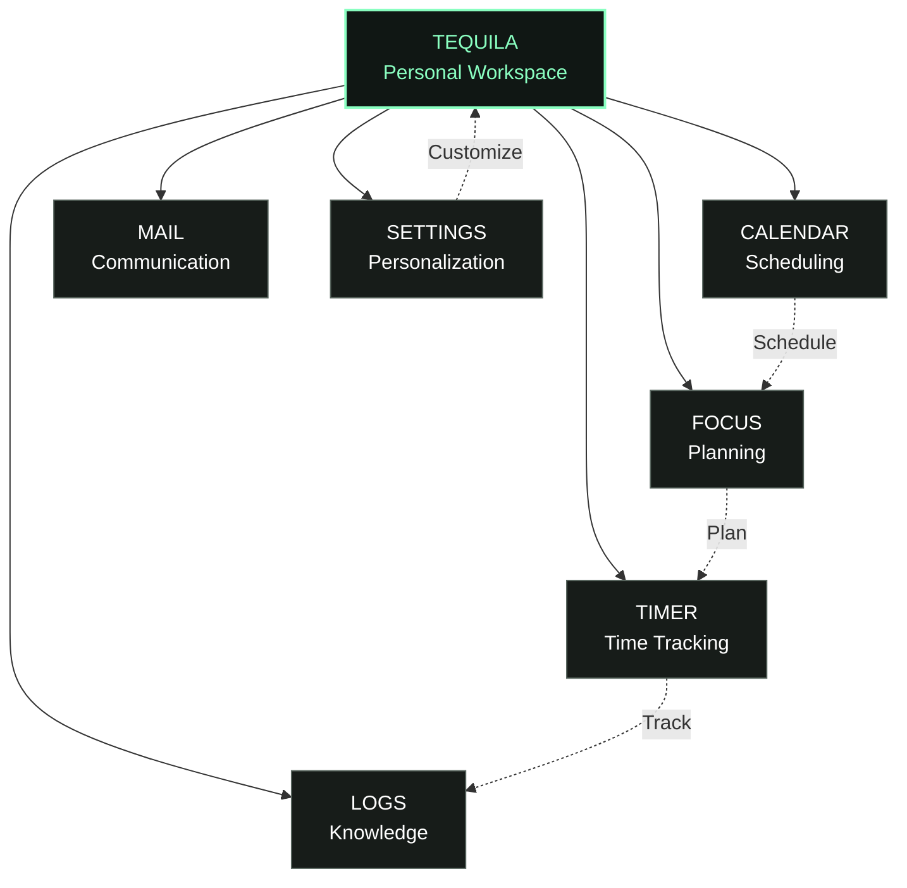
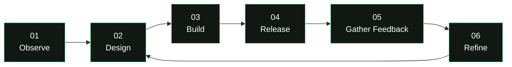

 <div align="center">

# T E Q U I L A

### A WORKSPACE, DESIGNED AROUND YOU.

**Plan with intention. Track with clarity. Work your way.**

A native macOS productivity workspace built with Swift, SwiftUI, and AppKit.

[Download Latest Release](https://github.com/caiyuyou1227-glitch/tequila/releases/latest) · [Explore Source Code](https://github.com/caiyuyou1227-glitch/tequila) · [Request a Feature](https://github.com/caiyuyou1227-glitch/tequila/discussions)

<br/>


</div>

---

## 00 / THE IDEA

> **Your workflow is personal. Your tools should be, too.**

Tequila began with a question: why should people adapt their working habits to the limitations of their software?

Many productivity tools prioritize functionality at the expense of visual coherence, while others offer polished interfaces without bringing everyday workflows together. I wanted to explore a different approach: a workspace where practical utility, visual design, and personalization are treated as parts of the same system.

Built as an independent project, Tequila brings six everyday workflows into one native macOS application.

The goal is not to build the application with the most features. It is to build a workspace in which the features, interface, and user's working habits make sense together.

**DESIGN PRINCIPLE / Function and form should work together.**

---

## 01 / THE SYSTEM

### Six modules. One workspace.



Each module serves a distinct purpose while sharing the same application and visual environment.

| Module | Core Function | Design Intent |
|:--|:--|:--|
| **Focus** | Task and date planning | Make priorities and progress visible |
| **Timer** | Count-up and countdown timing | Make time measurable |
| **Calendar** | Schedule visualization | Make time easier to interpret |
| **Mail** | Multi-account email | Bring communication together |
| **Logs** | Notes and research | Give information a structure |
| **Settings** | Interface customization | Give users control over their environment |

---

## 02 / THE MODULES

### 01 — FOCUS

**Know what needs doing. Know what is already done.**

Focus organizes tasks and important dates in a chronological workspace. The goal is to make progress visible without turning task management into another task.

- Create and organize daily schedules.
- Keep upcoming tasks and priorities in view.
- Distinguish completed tasks from unfinished ones at a glance.
- Track elapsed days and days remaining for important dates.
- Export daily task lists.

**v1.4 / Task Status**

Tasks now make completion status easier to recognize, helping users see what is finished and what still needs attention.

Because an unchecked task is not a completed task. It is just an optimistic little square.

**INTERFACE DETAIL / Clear status. Clearer decisions.**


---

### 02 — TIMER

**Turn time into something you can understand.**

A workspace for tracking sessions and organizing time across projects.

- Use count-up and countdown timers.
- Organize projects with custom folders.
- Track time spent on different activities.

Time is limited. At least now you can see where it went.


---

### 03 — CALENDAR

**Make schedules visual, not just informational.**

A customizable calendar designed around visual hierarchy and personal preference.

- Adjust colors, typography, and highlights.
- Customize the appearance of schedules.
- Export personalized monthly calendar views.


---

### 04 — MAIL

**Multiple inboxes. One place to work.**

Bring supported email accounts into a unified workspace.

Supported services:

- Gmail
- Outlook
- iCloud Mail
- Proton Mail
- Yahoo Mail
- 163 Mail
- QQ Mail


---

### 05 — LOGS

**Capture ideas. Organize what matters.**

Logs provides a place for notes, research, and project materials.

- Record ideas and working notes.
- Organize information into folders.
- Combine text with images and tables.


---

### 06 — SETTINGS

**The interface is part of the experience.**

Customization is not an afterthought. It is part of how Tequila is designed to be used.

- Customize backgrounds and colors.
- Adjust typography and interface preferences.
- Shape the visual environment around individual working habits.

Your workspace, your rules. Even the colors get a say.


---

## 03 / DESIGN SYSTEM

### Form follows use. Personalization follows the person.

Tequila treats visual design as part of product functionality.

An interface does more than display information. It determines what attracts attention, how information is organized, and how comfortably people interact with a tool over time.

Three principles guide the project:

#### 01 — Visual hierarchy

Information should be organized so users can distinguish priorities, navigate functions, and understand the interface without unnecessary visual noise.

The important things should stand out. Everything else should know its place.

#### 02 — Customization

People have different working habits and visual preferences. Adjustable colors, backgrounds, and typography give users greater control over their workspace.

A useful interface should accommodate different preferences rather than assume everyone sees the world in the same palette.

#### 03 — Functional coherence

The six modules should feel like parts of one product, rather than unrelated utilities placed inside the same window.

The challenge is to balance individual functionality with a consistent overall experience.

#### 04 — Feedback-driven refinement

A design decision is a hypothesis, not a permanent law.

Tequila evolves through use, feedback, and targeted revisions. The aim is to make the interface clearer and the product more useful—not to add features simply to make a release number go up.

---

## 04 / ENGINEERING

### From visual concept to native application.

Tequila is built specifically for macOS using Swift and Apple's interface frameworks.

```text
TEQUILA
│
├── Application
│   └── Native macOS experience
│
├── Interface
│   ├── SwiftUI
│   └── AppKit
│
├── Workspace
│   ├── Focus
│   ├── Timer
│   ├── Calendar
│   ├── Mail
│   ├── Logs
│   └── Settings
│
└── Distribution
    └── GitHub Releases
```

| Layer | Technology | Role |
|:--|:--|:--|
| Language | Swift | Application implementation |
| Interface | SwiftUI | Declarative interface development |
| Native framework | AppKit | macOS interface capabilities |
| Platform | macOS | Desktop environment |
| Distribution | GitHub Releases | Public builds and version history |

The project brings interface decisions and implementation into the same development process. Design choices must work not only as visual concepts, but also as parts of a functioning application.

**BUILD PRINCIPLE / A good interface must work, not just look like it does.**

---

## 05 / ITERATION

### A release is not the end of the process.

Tequila is developed through an ongoing cycle of observation, implementation, release, feedback, and revision.



### Release history

| Version | Focus | Changes |
|:--|:--|:--|
| **v1.0** | Initial release | Introduced the core workspace and six modules |
| **v1.1** | Interface refinement | Simplified the interface and removed unnecessary text |
| **v1.2** | Focus updates | Added count-up and countdown day counters; corrected wording inconsistencies |
| **v1.3** | Task timing | Refined count-up and countdown functionality in Tasks |
| **v1.4** | Task clarity | Added clearer completed and incomplete task indicators; made the delete button red for better visibility |

### v1.4 / Small changes. Less second-guessing.

This update focuses on a practical problem I encountered while using Tequila myself: I wanted to understand the state of my tasks more quickly, without having to inspect each one individually.

- **Task Status:** Completed and unfinished tasks are easier to distinguish at a glance.
- **Delete Button:** The delete control is now red, making its purpose more visually apparent.

These changes are intentionally simple. The goal is to reduce ambiguity in everyday use, not to make the interface more complicated.

Sometimes better design means adding a feature. Sometimes it means making the existing one harder to misunderstand.

**[Explore All Releases →](https://github.com/caiyuyou1227-glitch/tequila/releases)**

---

## 06 / PRODUCT DEMONSTRATION

### See the workspace in action.

Explore the interface, core modules, and product experience in the walkthrough below.

<div align="center">

[](https://youtu.be/N34f45MKJFo)

**[Watch the Full Demo on YouTube →](https://youtu.be/N34f45MKJFo)**

</div>

---

## 07 / GET STARTED

### Download

1. Open [GitHub Releases](https://github.com/caiyuyou1227-glitch/tequila/releases/latest).
2. Download the latest Tequila `.dmg` file.
3. Open the disk image and drag the application into your Applications folder.
4. Launch Tequila and personalize the workspace in Settings.

If macOS displays a security warning, verify the source and understand the implications before proceeding. Do not bypass security protections unless you trust the application.

### Build from source

Clone the public repository:

```bash
git clone https://github.com/caiyuyou1227-glitch/tequila.git
```

Open the Xcode project in a compatible macOS development environment and build the application.

---

## 08 / COMMUNITY

### Built independently. Open to ideas.

Tequila is publicly available for people to explore, test, and discuss.

Feedback is an important part of product development. A suggestion can reveal an unclear interaction, a usability issue, or an assumption worth reconsidering.

- **Feature requests:** [GitHub Discussions](https://github.com/caiyuyou1227-glitch/tequila/discussions)
- **Bug reports:** [GitHub Issues](https://github.com/caiyuyou1227-glitch/tequila/issues)
- **Source code:** [Browse the repository](https://github.com/caiyuyou1227-glitch/tequila)
- **Product demonstration:** [YouTube](https://youtu.be/N34f45MKJFo)

### Project showcase

Tequila has also been shared on Xiaohongshu as part of its public presentation and feedback process.

[View the Tequila showcase on Xiaohongshu](https://www.xiaohongshu.com/discovery/item/6aba2e980000000002013350?source=webshare&xhsshare=pc_web&xsec_token=AB1ofPMD2UY6B3QkhKaT0Fb_gjfxCuPxq-BM8BlBuhLOw=&xsec_source=pc_share)

Previously recorded post engagement:

| Metric | Count |
|:--|--:|
| Likes | 60 |
| Saves | 28 |
| Comments | 13 |
| Shares | 4 |

These figures represent engagement with the showcase post, not verified downloads or active users.

---

## 09 / BEHIND THE PROJECT

### Design thinking meets software engineering.

My background spans fashion design, fashion management, and 2D/3D creative production.

These experiences shaped my attention to visual structure, composition, hierarchy, and the relationship between form and function. Learning software development gave me a way to move beyond visual concepts and turn those ideas into interactive products.

Tequila brings these interests together through a practical process:

- **Observe** how people interact with tools.
- **Design** an interface around a clear purpose.
- **Build** the experience with native technologies.
- **Evaluate** the result through use and feedback.
- **Refine** the product through successive releases.

Developing Tequila has also changed how I think about design. A choice that looks right to its creator may not be the clearest choice for someone else. A feature that seems obvious during development may need a more visible signal in practice.

The project remains an ongoing exploration of how design and technology can work together to shape everyday digital experiences.

---

<div align="center">

### TEQUILA

**DESIGNED WITH INTENTION. BUILT TO EVOLVE.**

Native macOS · Independent Project · Open Source

[Download](https://github.com/caiyuyou1227-glitch/tequila/releases/latest) · [Source](https://github.com/caiyuyou1227-glitch/tequila) · [Discussions](https://github.com/caiyuyou1227-glitch/tequila/discussions)

</div>
