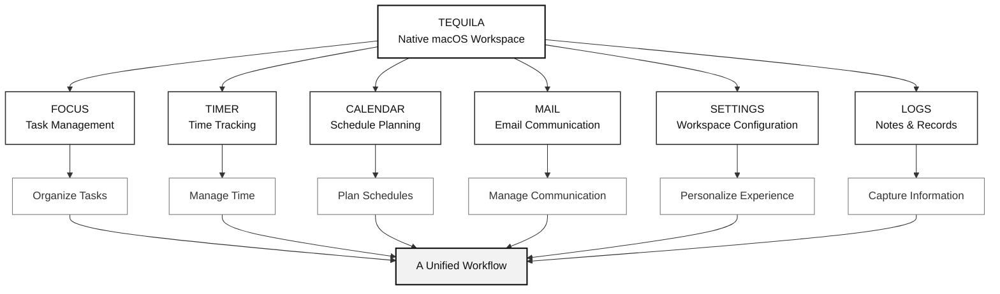
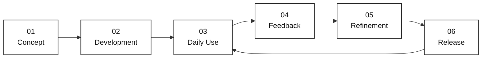

<div align="center">

# T E Q U I L A

### A Native macOS Workspace for Focused Work.

**Planning · Time Management · Communication · Notes**

[](https://www.apple.com/macos/)
[](https://www.swift.org/)
[](https://developer.apple.com/xcode/swiftui/)
[](https://github.com/caiyuyou1227-glitch/tequila/releases)
[](https://github.com/caiyuyou1227-glitch/tequila/stargazers)

<br>

A thoughtfully designed workspace that brings everyday productivity tools together in one native macOS experience.

<br>

[**Explore the Project**](https://github.com/caiyuyou1227-glitch/tequila)
&nbsp; · &nbsp;
[**Watch the Demo**](https://www.youtube.com/watch?v=Plah28XUPFI)
&nbsp; · &nbsp;
[**View Releases**](https://github.com/caiyuyou1227-glitch/tequila/releases)

</div>

---

# 00 / THE IDEA

### Productivity should feel effortless.

Productivity software often faces a trade-off: feature-rich tools can feel visually overwhelming, while beautifully designed applications may lack the flexibility needed for everyday work.

**Tequila** was created to bring these two priorities together.

Built as a native macOS application, Tequila integrates planning, time management, communication, and note organization into a unified workspace.

Rather than switching between disconnected applications, users can organize their work, manage their time, and maintain a clearer overview of their daily routines in one place.

> **One workspace. Multiple workflows. A more intentional way to work.**

---

# 01 / SYSTEM OVERVIEW

### One workspace. Six interconnected modules.

Tequila is organized around six core modules. Each serves a distinct purpose while contributing to a consistent productivity workflow.



---

# 02 / CORE MODULES

### Six modules. One cohesive experience.

Each module is designed around a specific aspect of everyday productivity, with a consistent interface and a clear functional purpose.

## 01 — FOCUS

**Task Management & Daily Planning**

A flexible task workspace for organizing priorities and structuring daily routines.

- **Task Organization** — Create, manage, and categorize tasks in one workspace.
- **Daily Planning** — Organize tasks around individual dates and daily schedules.
- **Fixed Tasks** — Assign tasks to selected weekdays or designate them as all-day tasks.
- **Date-Specific Status** — Completion and incomplete states are managed independently for the date selected by the user.
- **Flexible Visibility** — Hide selected tasks from the workspace without deleting them.
- **Task Prioritization** — Pin important tasks to maintain a clear view of current priorities.

## 02 — TIMER

**Time Management & Tracking**

A dedicated space for managing time and maintaining awareness of task duration.

- **Time Tracking** — Monitor elapsed time and countdowns.
- **Task Timing** — Keep track of time associated with individual activities.
- **Flexible Timing** — Use different timing modes according to the task.
- **Visual Clarity** — Keep time information accessible without unnecessary interface clutter.

## 03 — CALENDAR

**Scheduling & Time Organization**

A calendar workspace for viewing schedules and coordinating tasks across dates.

- **Calendar Overview** — View dates and organize schedules.
- **Task Coordination** — Connect daily planning with calendar-based organization.
- **Schedule Awareness** — Maintain a clearer overview of upcoming activities.
- **Flexible Planning** — Navigate between dates to review and organize plans.

## 04 — MAIL

**Multi-Account Email Management**

A centralized email workspace designed to simplify everyday communication.

- **Multiple Accounts** — Manage more than one email account.
- **Unified Access** — Keep email communication within the Tequila workspace.
- **Communication Workflow** — Reduce the need to switch between separate applications.

## 05 — SETTINGS

**Personalization & Workspace Configuration**

A dedicated control center for adapting the application to individual preferences.

- **Appearance Customization** — Adjust the visual presentation of the workspace.
- **Color Configuration** — Customize application colors through Settings.
- **Display Configuration** — Configure the information displayed in the interface.
- **Flexible Positioning** — Reposition the displayed region using the mouse.
- **Workspace Preferences** — Adjust available settings to create a more personal working environment.

## 06 — LOGS

**Notes, Records & Information Organization**

A space for collecting information and keeping useful records accessible.

- **Note Organization** — Record and organize information.
- **Information Storage** — Keep notes and reference material in one workspace.
- **Personal Records** — Maintain a convenient place for everyday written information.

---

# 03 / DESIGN SYSTEM

### Functionality, without visual noise.

Tequila follows a design approach centered on clarity, consistency, and usability.

**01 — Visual Hierarchy**

Information is arranged according to importance, helping users identify key actions and priorities quickly.

**02 — Minimal Interface**

Unnecessary text and decorative elements are reduced to keep attention on the work itself.

**03 — Customizable Appearance**

Users can adjust the application's visual presentation through Settings.

**04 — Consistent Interaction**

The six modules share a coherent interface language, creating a unified experience across different workflows.

**05 — Practical Iteration**

Interface decisions are refined through everyday use, usability observations, and user feedback.

---

# 04 / INTERFACE PREVIEW

### Explore the workspace.

Each screenshot represents a core part of the Tequila experience.

<div align="center">

### FOCUS — Task Management


<br>

### TIMER — Time Management


<br>

### CALENDAR — Schedule Planning


<br>

### MAIL — Email Communication


<br>

### SETTINGS — Workspace Configuration


<br>

### LOGS — Notes & Records


</div>

---

# 05 / PROJECT ARCHITECTURE

### Built natively for macOS.

Tequila is developed with Apple's native development technologies.

| Technology | Purpose |
|:---|:---|
| **Swift** | Core application logic |
| **SwiftUI** | Declarative user interface |
| **AppKit** | Native macOS integration |
| **Xcode** | Development and build environment |

### Project Structure

The repository is organized into application source code, test targets, project configuration, and visual resources.

```text
tequila/
│
├── screenshots/
│   ├── focus.png
│   ├── timer.png
│   ├── calendar.png
│   ├── mail.png
│   ├── settings.png
│   ├── logs.png
│   ├── install-1-download.png
│   ├── install-2-drag.png
│   ├── install-3-warning.png
│   └── install-4-open-anyway.png
│
├── tequila/
│   ├── Assets.xcassets/
│   │   └── Contents.json
│   │
│   ├── tequilaApp.swift
│   ├── ContentView.swift
│   └── tequila.entitlements
│
├── tequilaTests/
│   └── tequilaTests.swift
│
├── tequilaUITests/
│   ├── tequilaUITests.swift
│   └── tequilaUITestsLaunchTests.swift
│
├── tequila.xcodeproj/
│   ├── project.pbxproj
│   └── project.xcworkspace/
│       └── contents.xcworkspacedata
│
├── .gitignore
└── README.md
```

---

# 06 / DEVELOPMENT & ITERATION

### Designed. Tested. Refined.

Tequila is developed through an iterative process. Each release builds on the previous experience, with attention to functionality, usability, and interface consistency.



### Release History

| Release | Key Updates |
|:---|:---|
| **v1.0** | Initial release of the native macOS productivity workspace. |
| **v1.1** | Refined the interface, simplified visual elements, and improved usability. |
| **v1.2** | Introduced count-up and countdown day tracking. |
| **v1.3** | Expanded task timing with count-up and countdown functionality. |
| **v1.4** | Improved completed and incomplete task indicators and interaction clarity. |
| **v1.5** | Added weekly planning and weekday selection for fixed tasks, with more precise controls for managing scheduled days. |
| **v1.6** | Added All Day fixed tasks, date-specific completion states, and the ability to hide selected tasks without deleting them. |

### Continuous Improvement

The development process is informed by both personal daily use and feedback from different communities.

Feedback channels include:

- **GitHub** — Project discussions, issue reports, and feature suggestions.
- **Xiaohongshu** — User feedback and interface discussions.
- **Reddit** — Community perspectives and suggestions.

The goal is not simply to add more features, but to make existing workflows clearer, more flexible, and more practical.

---

# 07 / PRODUCT DEMO

### See Tequila in action.

Explore the interface and experience the main workflows in the demo video.

<div align="center">

<a href="https://www.youtube.com/watch?v=Plah28XUPFI">
  
</a>

<br>

[**Watch the Full Demo on YouTube →**](https://www.youtube.com/watch?v=Plah28XUPFI)

</div>

---

# 08 / GETTING STARTED

### Installation

Download the latest release from GitHub.

**Step 01 — Download**

Visit the Releases page and download the latest `.dmg` installer.

[Download Tequila](https://github.com/caiyuyou1227-glitch/tequila/releases)

**Step 02 — Open the Installer**

Double-click the downloaded `.dmg` file.


**Step 03 — Move to Applications**

Drag Tequila into the Applications folder.


**Step 04 — Open Tequila**

If macOS displays a security warning, follow the installation guidance provided in the screenshots.


---

### Build from Source

**Requirements**

- macOS
- Xcode
- Swift toolchain compatible with the project

**Steps**

```bash
# Clone the repository
git clone https://github.com/caiyuyou1227-glitch/tequila.git

# Enter the project directory
cd tequila

# Open the Xcode project
open tequila.xcodeproj
```

Select the `tequila` scheme and build the project in Xcode.

---

# 09 / COMMUNITY & CONTRIBUTION

### A project shaped by continuous feedback.

Tequila is an evolving project, and feedback helps guide future improvements.

Whether you encounter an issue, have a feature suggestion, or simply want to share your experience, contributions and discussions are welcome.

| Platform | Purpose |
|:---|:---|
| **GitHub Issues** | Report bugs and technical issues |
| **GitHub Discussions** | Share ideas and request features |
| **Xiaohongshu** | Product feedback and interface discussion |
| **Reddit** | Community discussion and suggestions |

- [GitHub Repository](https://github.com/caiyuyou1227-glitch/tequila)
- [GitHub Issues](https://github.com/caiyuyou1227-glitch/tequila/issues)
- [GitHub Discussions](https://github.com/caiyuyou1227-glitch/tequila/discussions)
- [Xiaohongshu](https://www.xiaohongshu.com/discovery/item/6aba2e980000000002013350?source=webshare&xhsshare=pc_web&xsec_token=AB1ofPMD2UY6B3QkhKaT0Fb_gjfxCuPxq-BM8BlBuhLOw=&xsec_source=pc_share)
- [Reddit](https://www.reddit.com/)

---

# 10 / BEHIND THE PROJECT

### Built from everyday needs.

Tequila began with a simple observation: productivity tools should be both functional and enjoyable to use.

The project has grown through independent development, personal experimentation, and continuous refinement.

From task organization to time tracking, from interface design to workflow customization, every part of Tequila reflects an ongoing effort to make everyday work more structured and intuitive.

**Tequila is more than a collection of productivity tools. It is an evolving workspace built around the way people work.**

<br>

<div align="center">

### T E Q U I L A

**Work with clarity. Organize with intention.**

[GitHub](https://github.com/caiyuyou1227-glitch/tequila)
&nbsp; · &nbsp;
[YouTube Demo](https://www.youtube.com/watch?v=Plah28XUPFI)

</div>
