<div align="center">

# T E Q U I L A

### A Native macOS Productivity Workspace

A unified workspace for planning, time management, communication, and personal organization.

<br>

[](https://www.apple.com/macos/)
[](https://www.swift.org/)
[](https://developer.apple.com/xcode/swiftui/)
[](https://github.com/caiyuyou1227-glitch/tequila/releases)
[](https://github.com/caiyuyou1227-glitch/tequila/stargazers)

<br>

[Overview](#01-overview) ·
[Architecture](#02-system-architecture) ·
[Modules](#03-core-modules) ·
[Design](#04-design-system) ·
[Technology](#05-technology-stack) ·
[Structure](#06-project-structure) ·
[Development](#07-development) ·
[Releases](#08-release-history) ·
[Demo](#09-product-demo) ·
[Screenshots](#10-screenshots) ·
[Installation](#11-installation) ·
[Community](#12-community--feedback) ·
[About](#13-behind-the-project)

</div>

---

# 01 / Overview

**Tequila** is a native macOS productivity application built with Swift, SwiftUI, and AppKit.

It integrates task management, time tracking, calendar planning, email communication, and personal organization into one unified workspace.

Rather than treating productivity as a collection of disconnected tools, Tequila brings essential workflows together in a consistent desktop environment.

The project explores how functionality and interface design can coexist without compromising either.

### Product Objectives

| Principle | Description |
|---|---|
| Functionality | Integrate essential productivity workflows into one workspace. |
| Visual Clarity | Reduce unnecessary interface elements and establish clear hierarchy. |
| Flexibility | Allow users to configure their workspace and organize tasks around individual routines. |
| Consistency | Maintain predictable interactions across different modules. |
| Iteration | Improve usability through daily use, observation, and external feedback. |

---

# 02 / System Architecture

Tequila is organized into six core modules, each addressing a distinct part of the productivity workflow.

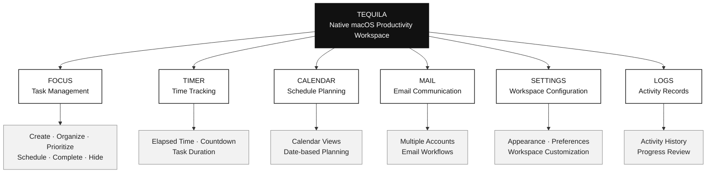

### Workflow Structure

| Layer | Role |
|---|---|
| Application | Provides a unified macOS workspace. |
| Core Modules | Separates productivity functions into six independent areas. |
| User Interaction | Supports task creation, scheduling, tracking, communication, and configuration. |
| Personal Workflow | Connects planning, execution, and activity review. |

---

# 03 / Core Modules

## 01 — Focus

**Task Management & Daily Execution**

- Create and organize tasks.
- Manage fixed and scheduled tasks.
- Set task priorities and visibility.
- Track completed and incomplete tasks.
- Configure recurring weekday schedules.
- Support count-up and countdown day tracking.
- Hide selected tasks without permanently deleting them.
- Manage task status independently for each selected date.

## 02 — Timer

**Time Management & Task Duration**

- Track elapsed time.
- Set countdown timers.
- Support time-based productivity workflows.
- Integrate timing into daily task management.

## 03 — Calendar

**Calendar Planning & Scheduling**

- View and organize scheduled events.
- Coordinate tasks with calendar dates.
- Maintain an overview of daily plans.

## 04 — Mail

**Integrated Email Communication**

- Connect multiple email accounts.
- Access email workflows within Tequila.
- Reduce the need to switch between separate applications.

## 05 — Settings

**Workspace Configuration & Personalization**

- Configure interface appearance.
- Customize workspace preferences.
- Adjust the region displayed in the upper-right corner.
- Reposition the displayed region using the mouse.
- Manage available visual settings.

## 06 — Logs

**Activity Records & Review**

- Review recorded activity.
- Maintain visibility into previous work.
- Support reflection and progress review.

---

# 04 / Design System

Tequila's interface is designed around clarity, consistency, and functional minimalism.

### Visual Principles

**01 — Minimalism**

Avoid unnecessary decoration and visual noise.

**02 — Hierarchy**

Make important information easier to identify through layout and visual emphasis.

**03 — Consistency**

Maintain predictable controls and interaction patterns across modules.

**04 — Flexibility**

Allow users to adapt the workspace to their individual preferences.

**05 — Practicality**

Prioritize usability and everyday workflows over purely decorative design decisions.

### Design Philosophy

The interface should support the work rather than compete with it.

Every visual element should have a purpose. Every interaction should communicate its function clearly.

---

# 05 / Technology Stack

| Technology | Application |
|---|---|
| Swift | Primary programming language |
| SwiftUI | Declarative user interface development |
| AppKit | Native macOS integration |
| Xcode | Development and build environment |
| Git | Version control |
| GitHub | Source code hosting and release distribution |

### Platform

- Native macOS application.
- Designed for desktop productivity workflows.
- Built with Apple's development frameworks.

---

# 06 / Project Structure

```text
tequila/
│
├── tequila/
│   ├── Assets.xcassets/
│   │   └── Contents.json
│   │
│   ├── tequila.entitlements
│   ├── tequilaApp.swift
│   └── ContentView.swift
│
├── tequilaTests/
│   └── tequilaTests.swift
│
├── tequilaUITests/
│   ├── tequilaUITests.swift
│   └── tequilaUITestsLaunchTests.swift
│
├── tequila.xcodeproj/
│   ├── project.pbxproj
│   └── project.xcworkspace/
│       └── contents.xcworkspacedata
│
├── screenshots/
│   ├── focus.png
│   ├── timer.png
│   ├── calendar.png
│   ├── mail.png
│   ├── settings.png
│   ├── logs.png
│   ├── install-1-download.png
│   ├── install-2-drag.png
│   ├── install-3-warning.png
│   └── install-4-open-anyway.png
│
├── settings.png
├── logs.png
├── README.md
└── .gitignore
```

### Directory Reference

| Component | Responsibility |
|---|---|
| `tequila/` | Main application source directory |
| `Assets.xcassets/` | Application assets and resources |
| `tequila.entitlements` | Application entitlements |
| `tequilaApp.swift` | Application entry point and lifecycle |
| `ContentView.swift` | Main interface and view composition |
| `tequilaTests/` | Unit testing |
| `tequilaUITests/` | User interface testing |
| `tequila.xcodeproj/` | Xcode project configuration |
| `screenshots/` | Product screenshots and installation guides |
| `README.md` | Project documentation |
| `.gitignore` | Git exclusion configuration |

---

# 07 / Development

## Requirements

- macOS
- Xcode
- Swift toolchain compatible with the project configuration

## Run Locally

**1. Clone the repository**

```bash
git clone https://github.com/caiyuyou1227-glitch/tequila.git
```

**2. Navigate to the project directory**

```bash
cd tequila
```

**3. Open the Xcode project**

```bash
open tequila.xcodeproj
```

**4. Run the application**

Select the `tequila` scheme and `My Mac` as the run destination, then build and run the application in Xcode.

## Build from Terminal

```bash
xcodebuild \
  -project tequila.xcodeproj \
  -scheme tequila \
  -configuration Release \
  -destination 'platform=macOS' \
  build
```

---

# 08 / Release History

Tequila is developed through continuous iteration. Each release focuses on improving usability, task organization, and the overall productivity experience.

## v1.6 — More Precise Task Control

### All-Day Fixed Tasks

- Added an `All Day` option to Fix, allowing a task to be scheduled for the entire day.
- Expanded scheduling flexibility for different daily routines.

### Date-Specific Completion Status

- Updated completed and incomplete task indicators to apply only to the currently selected date.
- Checking Fix on one date no longer automatically checks the same task across every other date on which it is scheduled.
- Task status changes and Fix operations are limited to the date selected by the user.

### Hide Tasks

- Added the ability to hide selected tasks after creation.
- Hidden tasks remain available without being permanently deleted.
- Helps keep the workspace focused on tasks that require immediate attention.

### Design Direction

More precise date-based task management, clearer task status, and greater control over daily organization.

---

## v1.5 — Weekly Planning

- Added weekday selection for fixed tasks.
- Improved recurring task scheduling.
- Distinguished between removing an individual weekday and clearing all fixed-day settings.
- Improved control over weekly routines.

## v1.4 — Task Status Refinement

- Improved the visual distinction between completed and incomplete tasks.
- Refined task status indicators.
- Updated delete button styling for clearer interaction feedback.

## v1.3 — Task Date Tracking

- Introduced count-up and countdown day tracking for tasks.
- Improved visibility into time-related task information.

## v1.2 — Date Tracking

- Expanded date-based task tracking.
- Added count-up and countdown functionality.

## v1.1 — Interface Refinement

- Simplified the interface.
- Removed unnecessary text and visual elements.
- Refined visual hierarchy based on feedback.
- Improved the balance between aesthetics and practical usability.

## v1.0 — Initial Release

- Introduced the core Tequila workspace.
- Established the six-module structure.
- Released the initial macOS application.

---

# 09 / Product Demo

<div align="center">

### Explore Tequila

[](https://www.youtube.com/watch?v=Plah28XUPFI)

**Watch the full product demonstration**

[YouTube — Tequila Demo](https://www.youtube.com/watch?v=Plah28XUPFI)

</div>

---

# 10 / Screenshots

## Focus

Task management and daily planning.

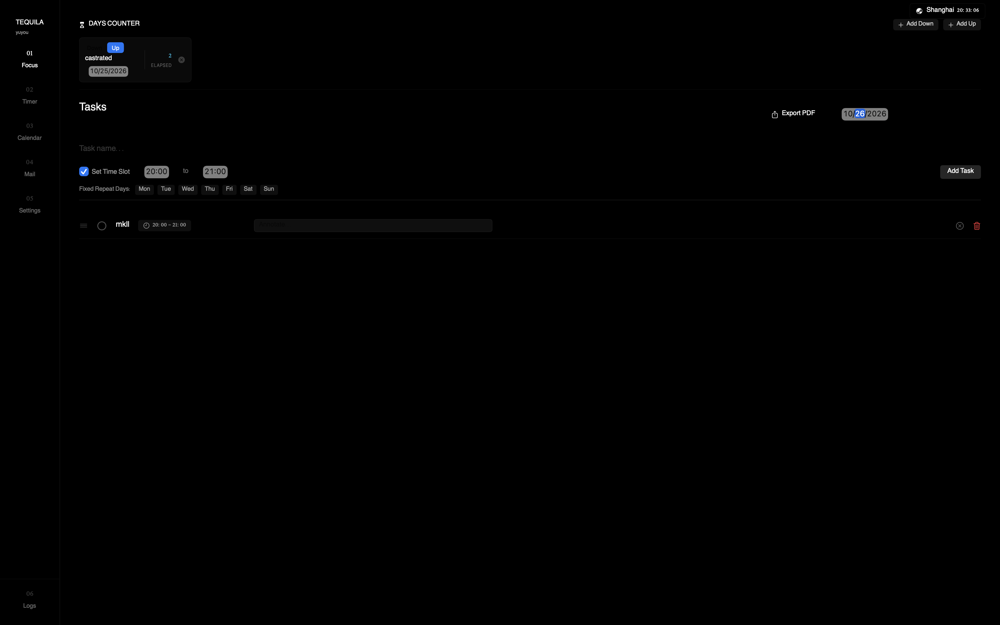

## Timer

Time tracking and countdown workflows.

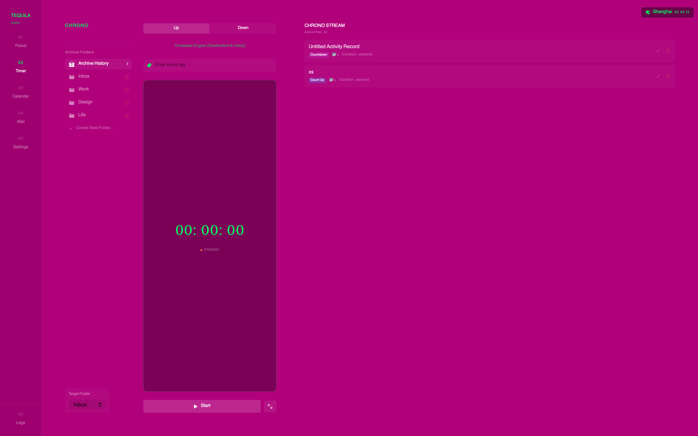

## Calendar

Calendar-based organization.

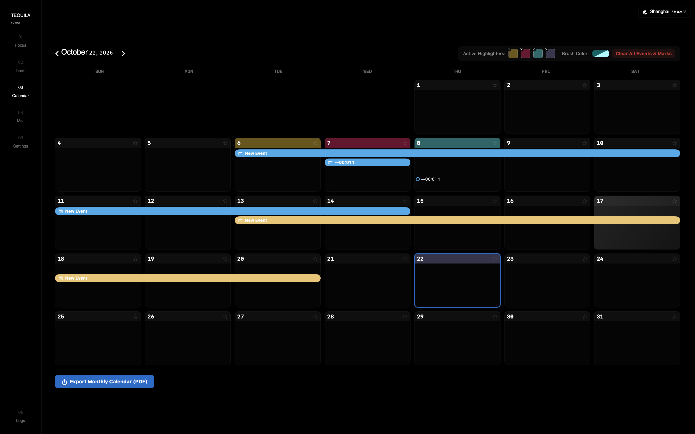

## Mail

Integrated email workspace.

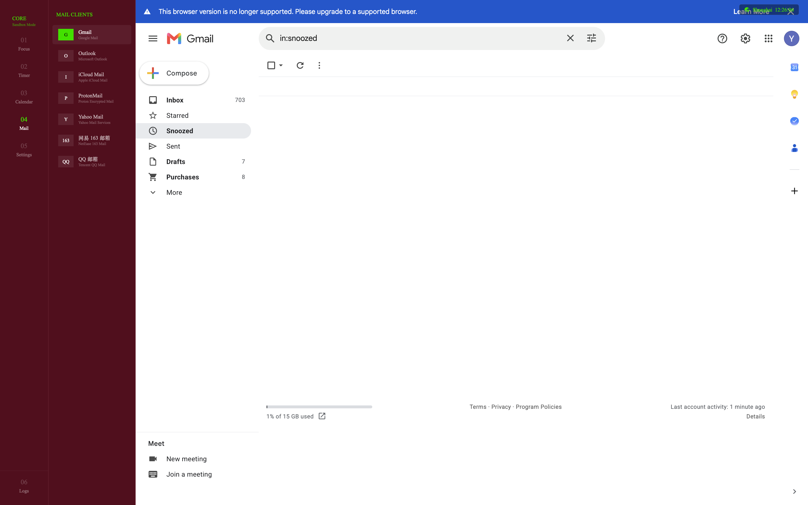

## Settings

Workspace configuration and personalization.

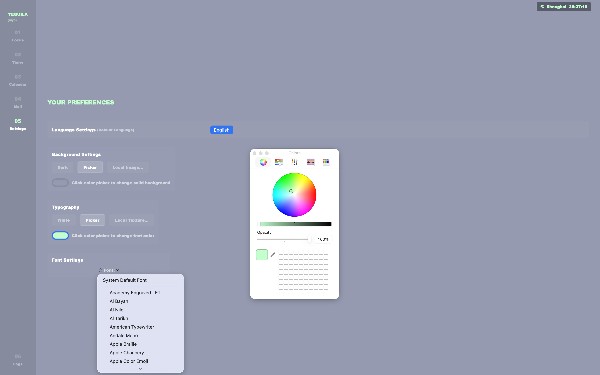

## Logs

Productivity activity records.

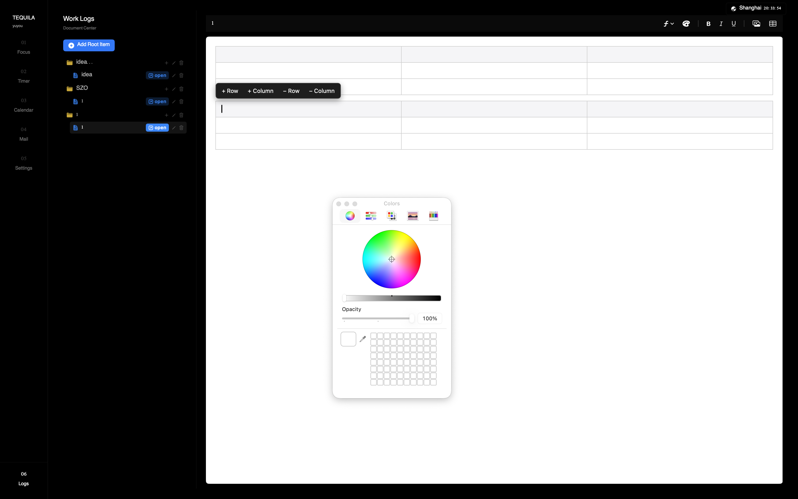

---

# 11 / Installation

Download the latest release from GitHub.

<div align="center">

[**DOWNLOAD TEQUILA**](https://github.com/caiyuyou1227-glitch/tequila/releases)

</div>

### Installation Steps

**01 — Download**

Download the latest `.dmg` file from the GitHub Releases page.

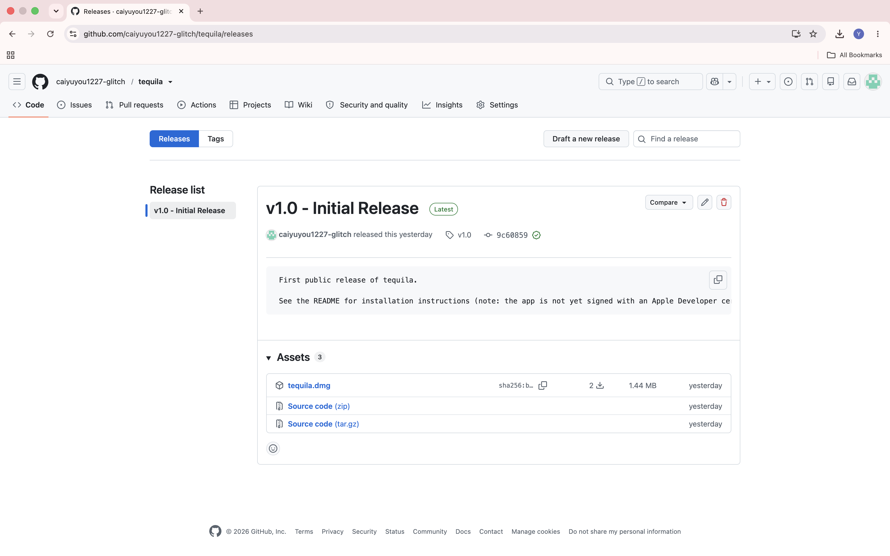

**02 — Install**

Open the downloaded disk image and drag Tequila into the Applications folder.

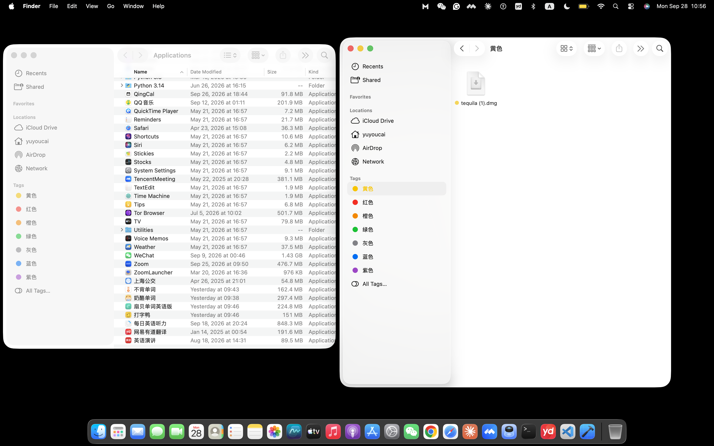

**03 — Security Notice**

If macOS displays a security warning, follow the instructions below.

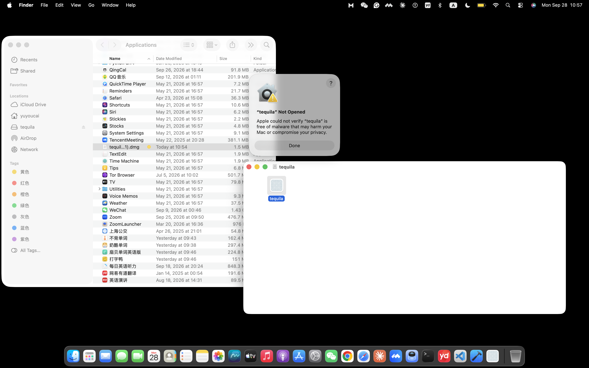

**04 — Open the Application**

Use the macOS security settings to allow the application to open if necessary.

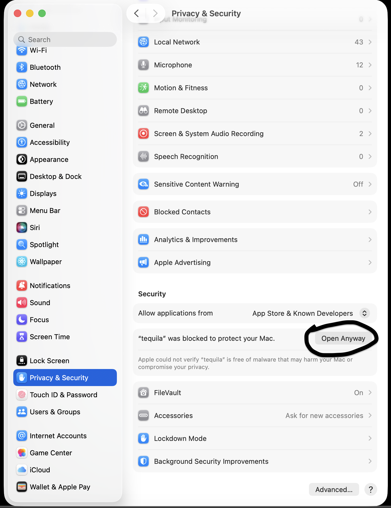

---

# 12 / Community & Feedback

Tequila continues to evolve through personal use and external feedback.

Feedback helps identify usability issues, evaluate design decisions, and guide future improvements.

### GitHub

Source code, issue reports, feature requests, and release updates.

- [Repository](https://github.com/caiyuyou1227-glitch/tequila)
- [Releases](https://github.com/caiyuyou1227-glitch/tequila/releases)
- [Issues](https://github.com/caiyuyou1227-glitch/tequila/issues)
- [Discussions](https://github.com/caiyuyou1227-glitch/tequila/discussions)

### Community Platforms

- [Xiaohongshu](https://www.xiaohongshu.com/discovery/item/6aba2e980000000002013350?source=webshare&xhsshare=pc_web&xsec_token=AB1ofPMD2UY6B3QkhKaT0Fb_gjfxCuPxq-BM8BlBuhLOw=&xsec_source=pc_share)
- Reddit — Community feedback and discussion.

---

# 13 / Behind the Project

Tequila began with a simple observation: productivity tools often require users to choose between extensive functionality and a well-considered interface.

I wanted to explore whether these two qualities could coexist in one native macOS application.

The project has evolved through independent development, daily use, and feedback-driven iteration. Instead of treating each release as a finished product, I use every version as an opportunity to reconsider existing interactions and improve the overall experience.

The goal is not simply to add more features, but to make the existing ones work better together.

<br>

<div align="center">

# TEQUILA

### Plan with clarity. Work with focus.

[GitHub Repository](https://github.com/caiyuyou1227-glitch/tequila)

</div>
